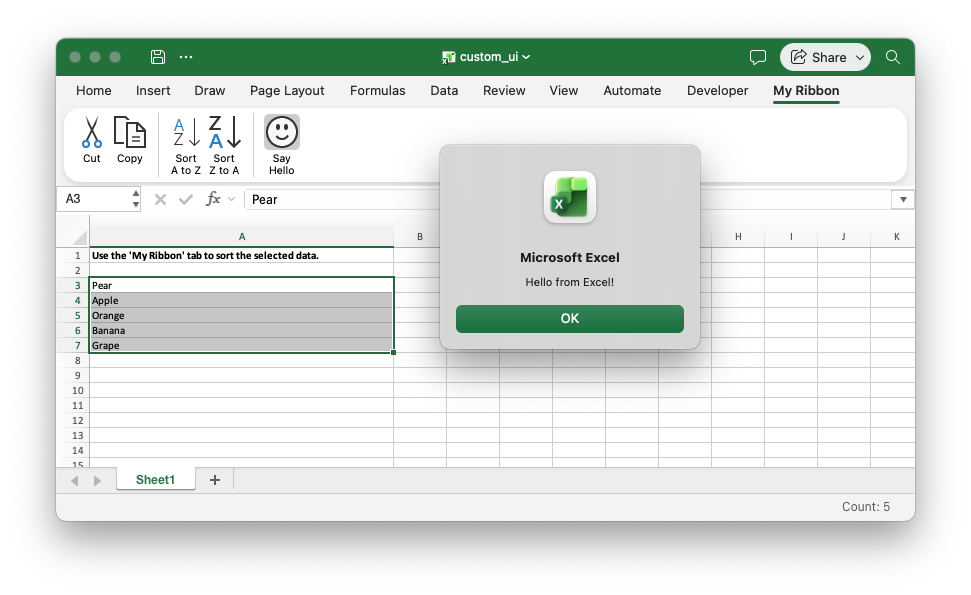

.. SPDX-License-Identifier: BSD-2-Clause
   Copyright (c) 2013-2026, John McNamara, jmcnamara@cpan.org

.. _ex_custom_ui:

Example: Adding a custom ribbon tab to a Workbook
=================================================

This program is an example of how to add a custom ribbon tab with built-in
Excel commands and a button connected to a VBA macro to a workbook.

See :ref:`customui` for more details. See :ref:`macros` for details on the VBA
project.

.. literalinclude:: ../../../examples/custom_ui.py

The Custom UI XML file used in the example is:

.. literalinclude:: ../../../examples/customUI14.xml
   :language: xml
