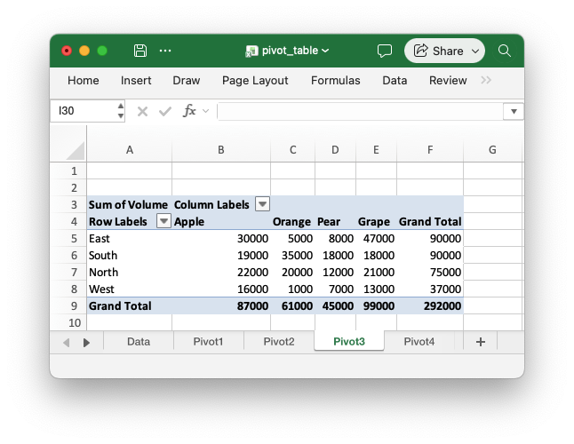

.. SPDX-License-Identifier: BSD-2-Clause
   Copyright (c) 2013-2026, John McNamara, jmcnamara@cpan.org

.. _ex_pivot_table:

Example: Pivot Tables
=====================

Example of how to add pivot tables to an XlsxWriter worksheet.

Pivot tables in Excel are a way of summarizing, grouping and analyzing a range
of source data.

See also :ref:`pivot_tables`.

.. literalinclude:: ../../../examples/pivot_table.py
