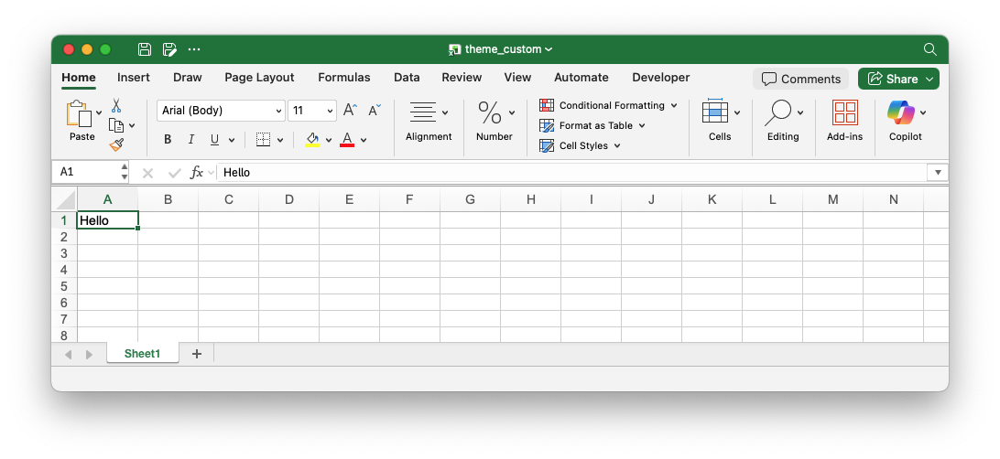

.. SPDX-License-Identifier: BSD-2-Clause
   Copyright (c) 2013-2026, John McNamara, jmcnamara@cpan.org

.. _ex_theme_custom:

Example: Using a Custom Theme
=============================

This program is an example of changing the default theme for a workbook to a
user supplied custom theme. See the :func:`use_custom_theme` workbook method
for more details.

.. literalinclude:: ../../../examples/theme_custom.py
