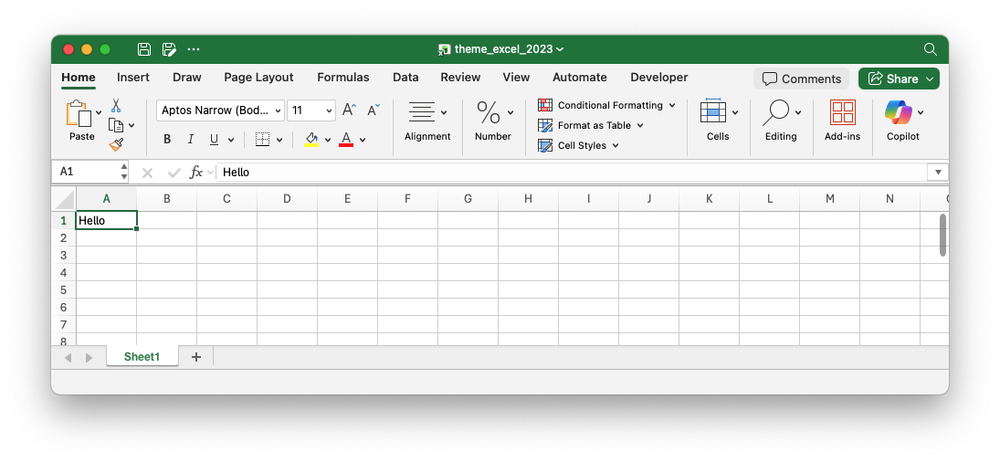

.. SPDX-License-Identifier: BSD-2-Clause
   Copyright (c) 2013-2026, John McNamara, jmcnamara@cpan.org

.. _ex_theme_excel_2023:

Example: Using the Excel 2023 Theme
===================================

This program is an example of changing the default theme for a workbook to the
Excel 2023 Office/Aptos theme using the ``excel_2023_theme`` constructor
option. See the :ref:`Workbook() <workbook>` constructor options for more
details.

.. literalinclude:: ../../../examples/theme_excel_2023.py
