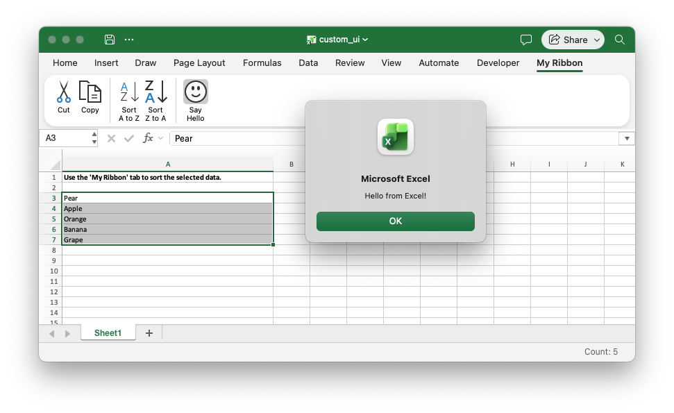

.. SPDX-License-Identifier: BSD-2-Clause
   Copyright (c) 2013-2026, John McNamara, jmcnamara@cpan.org

.. _customui:

Working with Custom UI Elements/Ribbons
=======================================

This section explains how to add custom UI elements to the Excel Ribbon
interface.

The code to produce the example above is shown below. The Cut, Copy and Sort
commands are defined in the ``customUI14.xml`` file. The "Say Hello" button is
also defined in the XML file but the macro is contained in the
``vbaProject_custom_ui.bin`` file:

.. literalinclude:: ../../../examples/custom_ui.py
   :start-at: import xlsxwriter

The Excel Custom UI format
--------------------------

Excel, and other Office applications, allow you to modify the Ribbon interface
via custom XML files. These files are defined as Custom UI XML using the Ribbon
schema and are embedded within the Excel file. These files enable customization
of the Ribbon interface with specific tabs, groups, buttons, dropdowns, and
other controls, including controls that run VBA macros.

Creating Custom UI XML files
~~~~~~~~~~~~~~~~~~~~~~~~~~~~

The easiest way to create Custom UI XML is with the `Office RibbonX Editor`_. It
can add Custom UI parts to an Excel file and provides templates, syntax
highlighting and schema validation. Once the ribbon works in Excel, save the XML
from the editor as a file to use with :func:`add_custom_ui()`.

If you already have an Excel file with a custom ribbon, the XML can be extracted
from it. Excel files are zip files and the Custom UI parts are stored as
``customUI/customUI.xml`` and ``customUI/customUI14.xml``.

.. _Office RibbonX Editor: https://github.com/fernandreu/office-ribbonx-editor

Excel 2007 and Excel 2010+ formats
~~~~~~~~~~~~~~~~~~~~~~~~~~~~~~~~~~

Excel supports two Ribbon schemas which are identified by the namespace of the
``customUI`` element:

* Excel 2007 format: ``http://schemas.microsoft.com/office/2006/01/customui``
* Excel 2010+ format: ``http://schemas.microsoft.com/office/2009/07/customui``

The Ribbon XML is the same in both formats apart from the namespace. However,
the Excel 2010+ format also supports customizing the Backstage view (the File
menu), via a ``backstage`` element, and right-click context menus, via a
``contextMenus`` element.

Excel uses the formats as follows:

* An Excel 2007 format file is used by all versions of Excel from Excel 2007
  onwards.
* An Excel 2010+ format file is used by Excel 2010 and later and is ignored by
  Excel 2007.
* If both are present, Excel 2007 uses the Excel 2007 format file and Excel
  2010 and later use the Excel 2010+ format file.

In practice, the Excel 2010+ format on its own is sufficient unless the file
needs to work in Excel 2007.

Adding Custom UI elements in XlsxWriter
---------------------------------------

The workbook :func:`add_custom_ui()` method is used to add the Custom UI XML
files to modify the Ribbon in an Excel file:

.. code-block:: python

   workbook.add_custom_ui('customUI14.xml')

The method can be called twice to add both Ribbon schema versions discussed
above:

.. code-block:: python

   # Add an Excel 2007 format ribbon.
   workbook.add_custom_ui('customUI.xml')

   # Add an Excel 2010+ format ribbon.
   workbook.add_custom_ui('customUI14.xml')

If the input XML file can't be read, an ``OSError`` exception is raised. If the
file isn't valid XML, doesn't have a ``customUI`` root element with a recognized
namespace, or has the same schema version as a previously added file, a
:exc:`CustomUIFileError` exception is raised.

Note, XlsxWriter only checks that the XML file is well-formed and has a
recognized root element. It doesn't validate the XML against the Ribbon schema.
Excel ignores Custom UI files with errors, without a warning, so users should
verify the XML in `Office RibbonX Editor`_ or check that the ribbon is displayed
as expected when the file is opened in Excel.

The Custom UI XML structure
---------------------------

A Custom UI file has a ``customUI`` root element that contains a ``ribbon``
element. The ribbon contains ``tabs``, each ``tab`` contains one or more
``group`` elements, and each group contains controls such as ``button``,
``toggleButton``, ``checkBox``, ``dropDown``, ``menu`` or ``separator``.

This is the XML file used to create the "My Ribbon" tab shown at the top of
this page:

.. literalinclude:: ../../../examples/customUI14.xml
   :language: xml

The most commonly used attributes are:

* ``id``: A unique identifier for a custom tab, group or control.

* ``idMso``: Refers to a built-in Excel tab, group or control instead of a
  custom one. For example ``<button idMso="Copy"/>`` adds Excel's own Copy
  button to a group, and ``<tab idMso="TabHome">`` can be used to add a custom
  group to the existing Home tab.

* ``label``: The text shown for the tab, group or control.

* ``imageMso``: The name of a built-in Office icon to use for a custom control.

* ``size``: The control size, ``"normal"`` or ``"large"``.

* ``screentip`` and ``supertip``: The tooltip title and description.

* ``onAction``: The VBA procedure to run when the control is clicked. See
  `Integration with VBA projects`_ below.

The best way to work with this format is to use the `Office RibbonX Editor`_
discussed above.

The names of the built-in controls and tabs that can be used with ``idMso`` are
listed in Microsoft's `Office Fluent UI command identifiers
<https://github.com/OfficeDev/office-fluent-ui-command-identifiers>`_. The
easiest way to find the name of a single control, in Excel for Windows, is to
hover over it in the "Customize the Ribbon" dialog, where the name is shown in
brackets in the tooltip.

Integration with VBA projects
-----------------------------

Custom UI elements that reuse built-in Excel commands, via ``idMso``, can be
completely defined in the Custom UI XML. The Cut, Copy and Sort buttons in the
example above are built-in commands of this kind.

Custom UI elements that provide additional functionality typically require VBA
code. The ``onAction`` callbacks referenced in the XML must be implemented as
VBA procedures that take an ``IRibbonControl`` parameter. For example, the "Say
Hello" button in the XML above has ``onAction="say_hello_callback"``, which is
implemented in the example's VBA project as:

.. code-block:: vbscript

   Sub say_hello_callback(control As IRibbonControl)
       say_hello
   End Sub

   Sub say_hello()
       MsgBox "Hello from Excel!"
   End Sub

A procedure without the ``IRibbonControl`` parameter, such as ``say_hello()``
above or a macro written for a worksheet button, can't be used directly as a
callback. Excel shows a "Wrong number of arguments" error when the control is
clicked. Instead, as in the example, call the existing macro from a callback.

When combining Custom UI with VBA, use both :func:`add_custom_ui()` and
:func:`add_vba_project()`:

.. code-block:: python

   import xlsxwriter

   # Note the .xlsm extension, which is required for VBA macros.
   workbook = xlsxwriter.Workbook('custom_ui.xlsm')

   # Add the Custom UI XML file for the Excel 2010+ ribbon.
   workbook.add_custom_ui('customUI14.xml')

   # Add the VBA project with the macro used by the ribbon button.
   workbook.add_vba_project('vbaProject_custom_ui.bin')

   worksheet = workbook.add_worksheet()
   worksheet.write(0, 0, "Use the 'My Ribbon' tab.")

   workbook.close()

See :ref:`macros` for details on extracting and adding a VBA project.

Excel files that contain Custom UI elements must use an ``xlsm`` extension
when they also include VBA code but can use ``xlsx`` for Custom UI without
macros.

Microsoft documentation
-----------------------

For more information on the Custom UI XML see the following Microsoft
documentation:

* `Customize the Office Fluent ribbon by using an Open XML formats file
  <https://learn.microsoft.com/en-us/office/vba/library-reference/concepts/customize-the-office-fluent-ribbon-by-using-an-open-xml-formats-file>`_.
  A short introduction to adding a custom ribbon to a file.

* `Customizing the 2007 Office Fluent Ribbon for Developers
  <https://learn.microsoft.com/en-us/previous-versions/office/developer/office-2007/aa338202(v=office.12)>`_.
  A detailed guide to the ribbon elements, attributes and VBA callbacks. It
  dates from Excel 2007 but still applies to current versions.

* `Targeting User Interface Solutions to the 2007 and 2010 Releases of Microsoft Office
  <https://learn.microsoft.com/en-us/previous-versions/office/developer/office-2010/ee704588(v=office.14)>`_.
  Explains the differences between the Excel 2007 and Excel 2010+ formats.

* `[MS-CUSTOMUI2]: Custom UI XML Markup Version 2 Specification
  <https://learn.microsoft.com/en-us/openspecs/office_standards/ms-customui2/452a58ae-cb0a-4926-83f8-fb1cbaa6114c>`_.
  The formal specification of the Excel 2010+ format.
