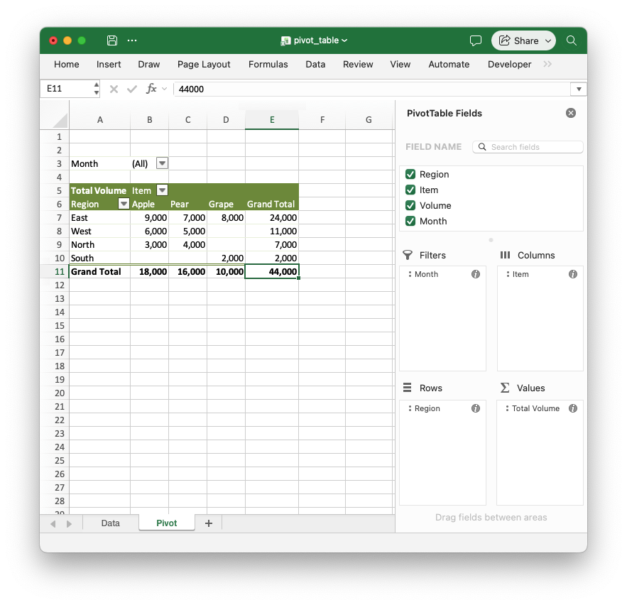
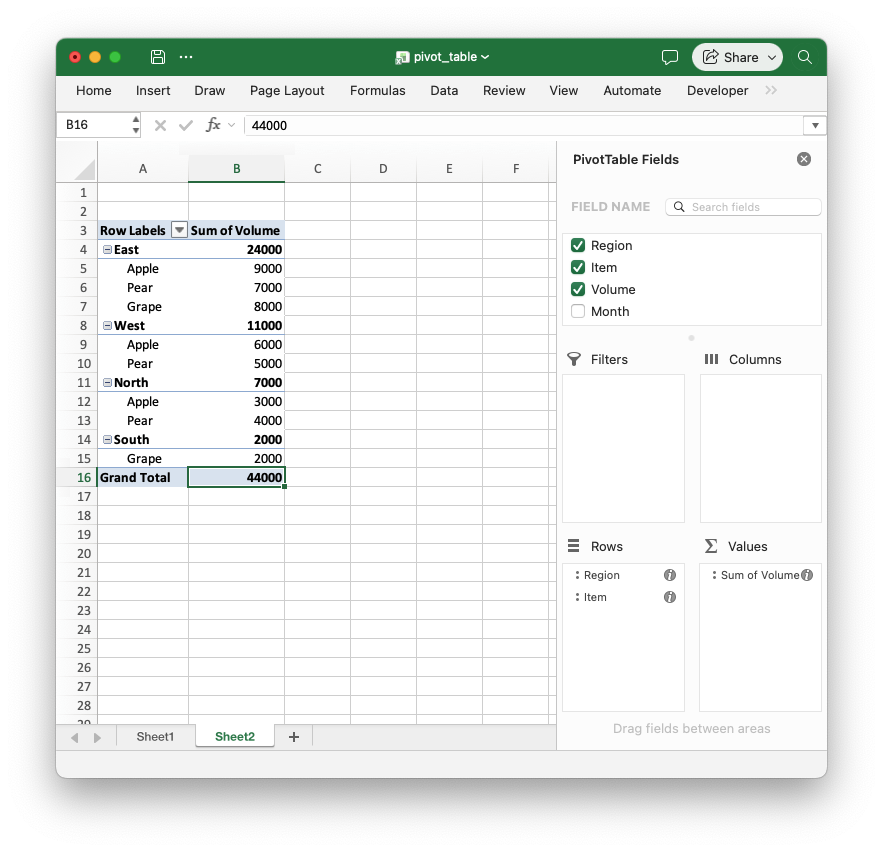
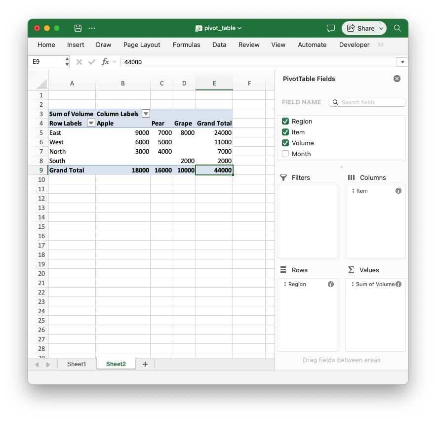
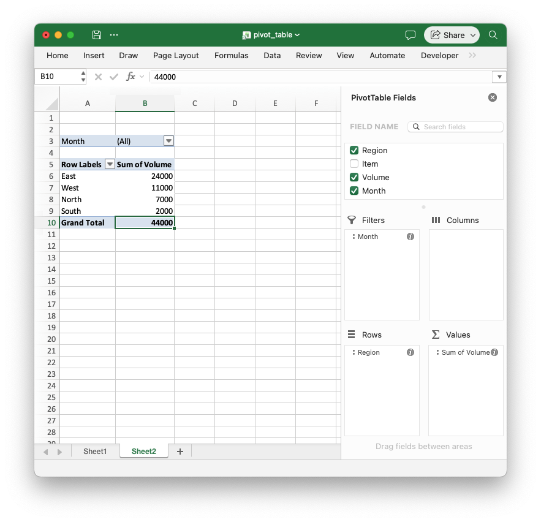
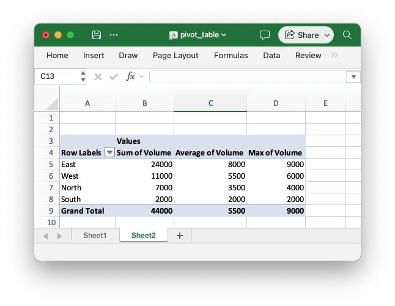
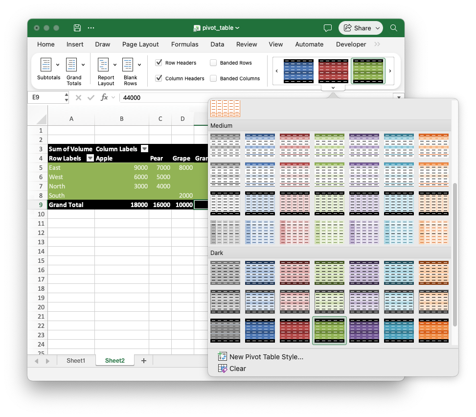
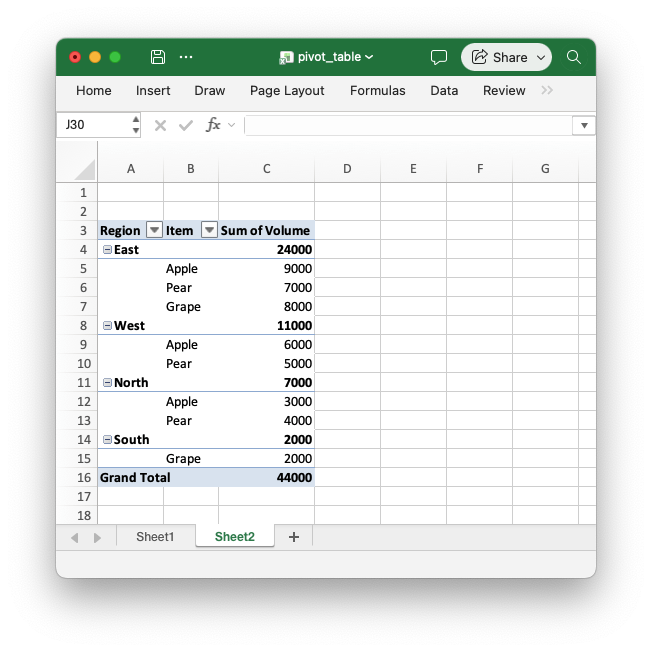
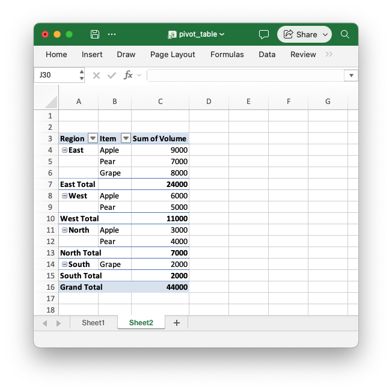
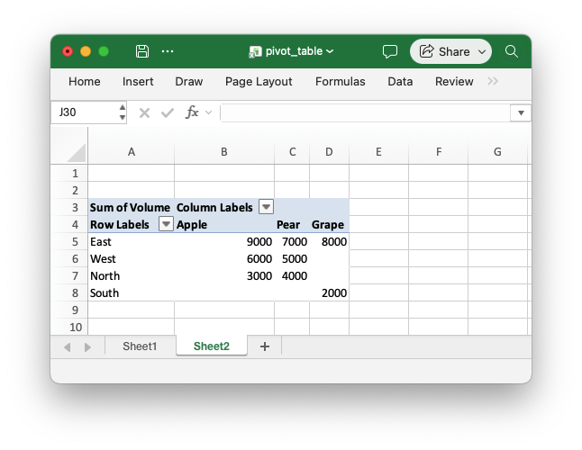

.. SPDX-License-Identifier: BSD-2-Clause
   Copyright (c) 2013-2026, John McNamara, jmcnamara@cpan.org

.. _pivot_tables:

Working with Pivot Tables
=========================

Pivot tables in Excel are a way of summarizing, grouping and analyzing a range
of source data. The unique values of the source data fields can be arranged as
row and column labels, and the numeric fields are summarized, for example as a
sum or an average, for each label. Pivot tables can also have filter fields,
different layouts and formatting styles.

For more information see `Overview of PivotTables and PivotCharts
<https://support.microsoft.com/en-us/office/overview-of-pivottables-and-pivotcharts-527c8fa3-02c0-445a-a2db-7794676bce96>`_
in the Microsoft Office documentation.

Here is an example that generates the pivot table shown above::

    import xlsxwriter

    workbook = xlsxwriter.Workbook('pivot_table.xlsx')

    # Add a worksheet for the source data.
    worksheet = workbook.add_worksheet('Data')

    # Some sample data to summarize.
    data = [
        ['East',  'Apple', 9000, 'July'],
        ['West',  'Pear',  5000, 'July'],
        ['North', 'Apple', 3000, 'August'],
        ['East',  'Grape', 8000, 'August'],
        ['West',  'Apple', 6000, 'September'],
        ['North', 'Pear',  4000, 'September'],
        ['East',  'Pear',  7000, 'October'],
        ['South', 'Grape', 2000, 'October'],
    ]

    # Write the header row and the data.
    worksheet.write_row(0, 0, ['Region', 'Item', 'Volume', 'Month'])
    for row, row_data in enumerate(data, 1):
        worksheet.write_row(row, 0, row_data)

    # Add a worksheet for the pivot table and add a pivot table that
    # summarizes the "Volume" by "Region" and "Item", with a filter on "Month".
    worksheet = workbook.add_worksheet('Pivot')
    worksheet.add_pivot_table('A3', {
        'source': 'Data!A1:D9',
        'rows': ['Region'],
        'columns': ['Item'],
        'filters': ['Month'],
        'values': [{'field': 'Volume',
                    'function': 'sum',
                    'name': 'Total Volume',
                    'num_format': '#,##0'}],
        'style': 'Pivot Style Medium 4',
        'layout': 'tabular',
    })

    workbook.close()

See also :ref:`ex_pivot_table`.

add_pivot_table()
-----------------

Pivot tables are added to a worksheet using the :func:`add_pivot_table()`
method::

    worksheet.add_pivot_table('A3', {options})

The position is the top left cell of the pivot table, including any filter
fields. It can be specified in 'A1' or 'Row/Column' notation (see
:ref:`cell_notation`)::

    worksheet.add_pivot_table('A3', {'source': 'Sheet1!A1:D9'})
    # Same as:
    worksheet.add_pivot_table(2, 0, {'source': 'Sheet1!A1:D9'})

The source data is written to the worksheet using the standard ``write()``
methods. The first row of the source data range must be a header row with the
names of the fields.

The options parameter should be a dict containing the pivot table options. The
available options are:

+---------------------+
| source              |
+---------------------+
| rows                |
+---------------------+
| columns             |
+---------------------+
| filters             |
+---------------------+
| values              |
+---------------------+
| style               |
+---------------------+
| layout              |
+---------------------+
| row_grand_totals    |
+---------------------+
| column_grand_totals |
+---------------------+
| field_names         |
+---------------------+

The ``source`` option is required. The other options are explained below.
The examples in the following sections use the data from the example above,
written to ``Sheet1``, with the pivot table added to a second worksheet.

All errors in the pivot table options or source data raise a
``PivotTableError`` exception. Errors that depend on the source data, such as
field names that don't match the headers, are raised when the workbook is
closed.

source
------

The ``source`` option sets the range of the source data, including the header
row. It can be a range string or a list of the sheet name and the zero indexed
first row, first column, last row and last column::

    worksheet.add_pivot_table('A3', {'source': 'Sheet1!A1:D9'})
    # Same as:
    worksheet.add_pivot_table('A3', {'source': ['Sheet1', 0, 0, 8, 3]})

Sheet names that contain spaces or other special characters should be quoted
in the range string, as in Excel::

    worksheet.add_pivot_table('A3', {'source': "'Sales Data'!A1:D9"})

The source data must have a header row and at least one row of data. The
header cells must be unique, non-blank strings. See the
:ref:`pivot_table_limitations` section below.

rows
----

The ``rows`` option sets a list of the fields that are used as row labels in
the pivot table::

    worksheet.add_pivot_table('A3', {
        'source': 'Sheet1!A1:D9',
        'rows': ['Region', 'Item'],
        'values': [{'field': 'Volume'}],
    })

Each field name must match a header in the source data, including case. If
there is more than one row field the second and later fields are grouped
within the previous field.

columns
-------

The ``columns`` option sets a list of the fields that are used as column
labels in the pivot table::

    worksheet.add_pivot_table('A3', {
        'source': 'Sheet1!A1:D9',
        'rows': ['Region'],
        'columns': ['Item'],
        'values': [{'field': 'Volume'}],
    })

filters
-------

The ``filters`` option sets a list of the fields that are used to filter the
pivot table::

    worksheet.add_pivot_table('A3', {
        'source': 'Sheet1!A1:D9',
        'rows': ['Region'],
        'filters': ['Month'],
        'values': [{'field': 'Volume'}],
    })

The filter fields are displayed above the pivot table, starting at the pivot
table position. The body of the pivot table starts after the filters and a
blank row.

A field can only be used once in the ``rows``, ``columns`` and ``filters``
options but it can also be used in the ``values`` option.

values
------

The ``values`` option sets a list of the fields that are summarized in the
body of the pivot table. Each value field is a dict with the following keys:

* ``field``: The name of the source data field. This is required.

* ``function``: The function used to summarize the field. The default is
  ``'sum'``. The available functions are:

  ===================  ===================================
  Function             Description
  ===================  ===================================
  ``'sum'``            Sum of the values (the default).
  ``'count'``          Count of the values.
  ``'average'``        Average of the values.
  ``'max'``            Maximum value.
  ``'min'``            Minimum value.
  ``'product'``        Product of the values.
  ``'count_numbers'``  Count of the numeric values.
  ``'std_dev'``        Standard deviation of a sample.
  ``'std_devp'``       Standard deviation of a population.
  ``'var'``            Variance of a sample.
  ``'varp'``           Variance of a population.
  ===================  ===================================

* ``name``: A custom name for the value field. The default name is based on the
  function and field such as "Sum of Volume". A custom name must be unique,
  ignoring case, and it can't be the same as a header in the source data.

* ``num_format``: A number format for the value field, such as ``'#,##0'``.
  See :func:`set_num_format()`.

For example::

    worksheet.add_pivot_table('A3', {
        'source': 'Sheet1!A1:D9',
        'rows': ['Region'],
        'values': [
            {'field': 'Volume'},
            {'field': 'Volume', 'function': 'average'},
            {'field': 'Volume', 'function': 'max'},
        ],
    })

If there is more than one value field, they are displayed in separate columns.

A value field can also have a custom name and number format::

    worksheet.add_pivot_table('A3', {
        'source': 'Sheet1!A1:D9',
        'rows': ['Region'],
        'values': [{'field': 'Volume', 'name': 'Total Volume',
                    'num_format': '$#,##0'}],
    })

style
-----

The ``style`` option sets the style of the pivot table. Standard Excel pivot
table style names should be used::

    worksheet.add_pivot_table('A3', {
        'source': 'Sheet1!A1:D9',
        'rows': ['Region'],
        'columns': ['Item'],
        'values': [{'field': 'Volume'}],
        'style': 'Pivot Style Dark 18',
    })

The available styles are 'Pivot Style Light 1' to 'Pivot Style Light 28',
'Pivot Style Medium 1' to 'Pivot Style Medium 28' and 'Pivot Style Dark 1' to
'Pivot Style Dark 28'. The default style is 'Pivot Style Light 16'.

You can also turn the style off by setting it to ``None``.

layout
------

The ``layout`` option sets the layout of the pivot table. The available
layouts are:

* ``'compact'``: The row fields are displayed in a single column. This is the
  default.
* ``'outline'``: Each row field is displayed in its own column and the items
  of the next field are displayed below the item in the current field.
* ``'tabular'``: Each row field is displayed in its own column and the items
  of the next field start on the same row as the item in the current field.

For example, the outline layout::

    worksheet.add_pivot_table('A3', {
        'source': 'Sheet1!A1:D9',
        'rows': ['Region', 'Item'],
        'values': [{'field': 'Volume'}],
        'layout': 'outline',
    })

And the tabular layout::

    worksheet.add_pivot_table('A3', {
        'source': 'Sheet1!A1:D9',
        'rows': ['Region', 'Item'],
        'values': [{'field': 'Volume'}],
        'layout': 'tabular',
    })

row_grand_totals
----------------

The ``row_grand_totals`` option turns the grand totals for rows on or off. The
row grand totals are displayed in the "Grand Total" column on the right of the
pivot table. The default is ``True``.

column_grand_totals
-------------------

The ``column_grand_totals`` option turns the grand totals for columns on or
off. The column grand totals are displayed in the "Grand Total" row at the
bottom of the pivot table. The default is ``True``.

Here is an example with both the row and column grand totals turned off::

    worksheet.add_pivot_table('A3', {
        'source': 'Sheet1!A1:D9',
        'rows': ['Region'],
        'columns': ['Item'],
        'values': [{'field': 'Volume'}],
        'row_grand_totals': False,
        'column_grand_totals': False,
    })

field_names
-----------

The ``field_names`` option sets the names of the source data fields. It is
only required if the source data is on a worksheet in ``constant_memory`` mode,
see :ref:`memory_perf`. In that mode the header row has already been written to
disk when the workbook is closed and can't be read::

    worksheet.add_pivot_table('A3', {
        'source': 'Sheet1!A1:D9',
        'field_names': ['Region', 'Item', 'Volume', 'Month'],
        'rows': ['Region'],
        'values': [{'field': 'Volume'}],
    })

There must be a field name for each column of the source data. If the source
data isn't in ``constant_memory`` mode the field names must match the headers.

.. _pivot_table_limitations:

Pivot Table Limitations
-----------------------

Pivot tables in Excel use a cache of the source data. This data is filtered and
summarized to create the pivot table. XlsxWriter doesn't store the cached data,
so the pivot table is written without its data. When Excel opens the file, it
builds the cache and the pivot table from the source data. This leads to the
following limitations:

* Applications that don't refresh pivot tables when the file is opened will
  show an empty pivot table. This also applies to pivot tables on protected
  worksheets.

* Excel will ask the end user to save the file even if no visible changes were
  made.

* The size of the pivot table isn't known until Excel builds it, so only the
  top left cells of the pivot table are checked for overlaps with worksheet
  tables, merged ranges, other pivot tables and the source data. Excel will
  show an error if the full pivot table overlaps them.

In addition, the header cells of the source data must be strings or rich
strings. Number, boolean and formula header cells aren't currently supported.
